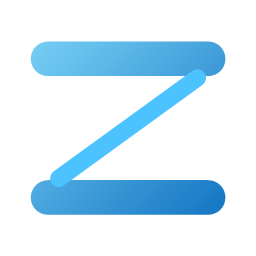
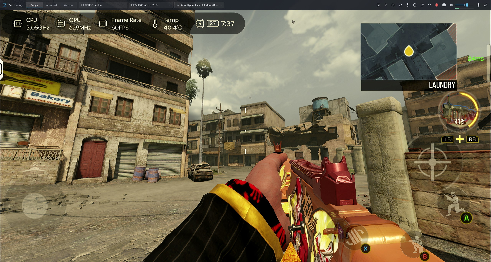
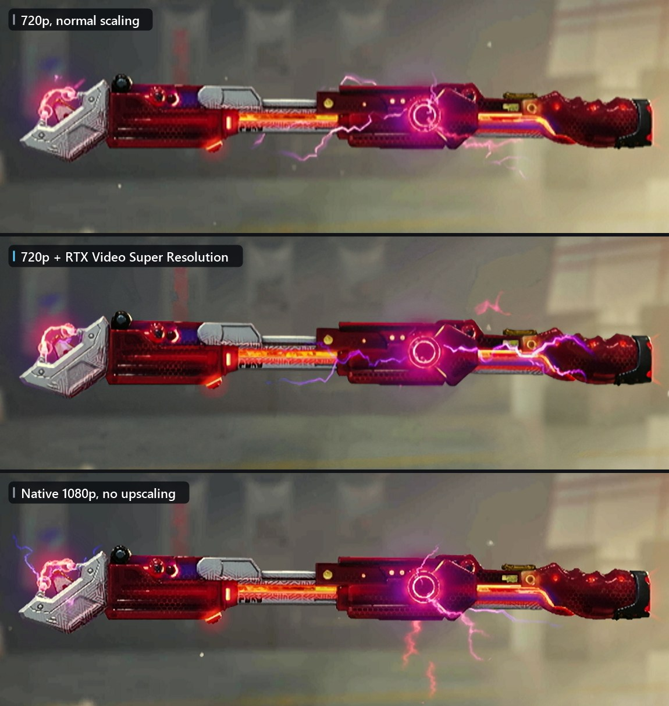
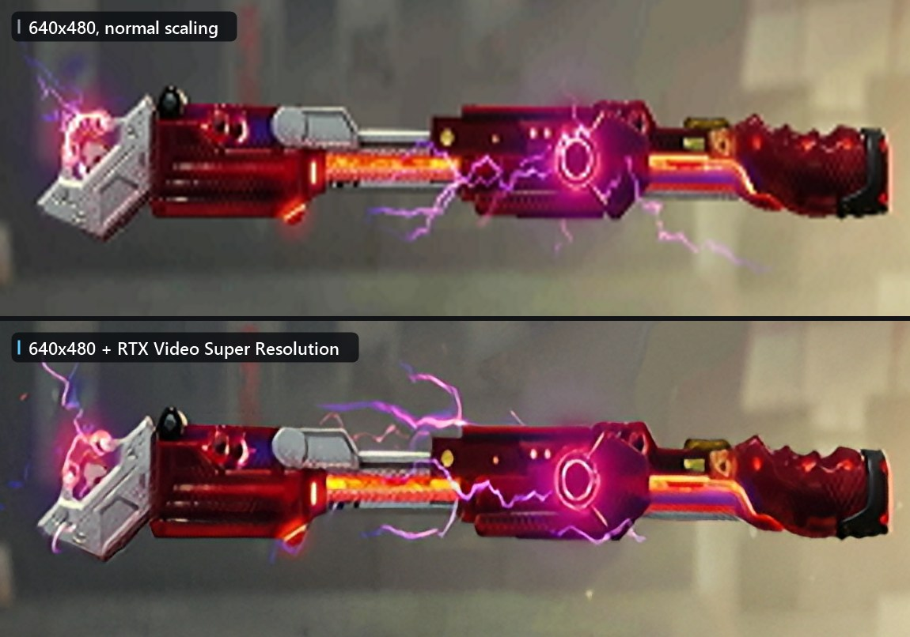
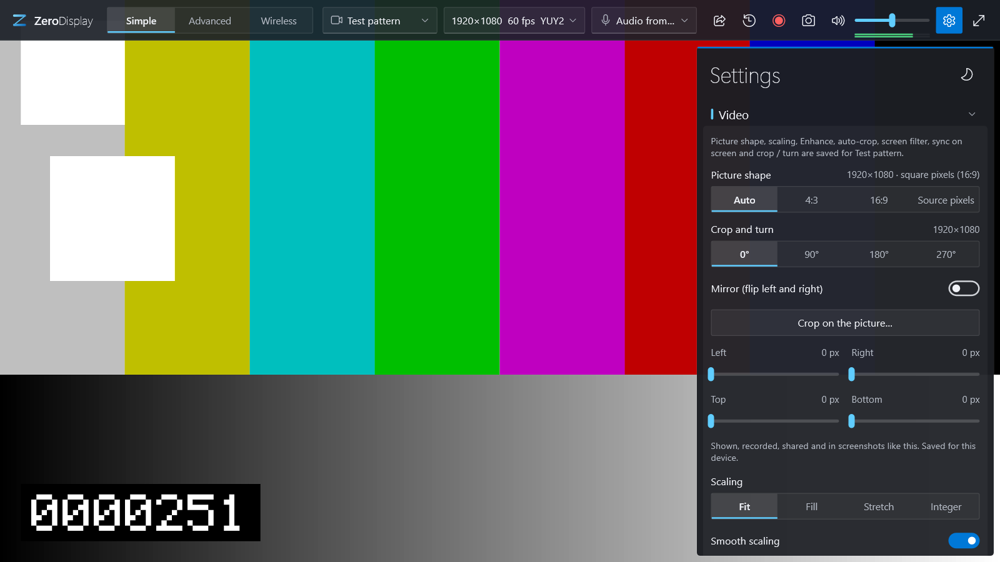
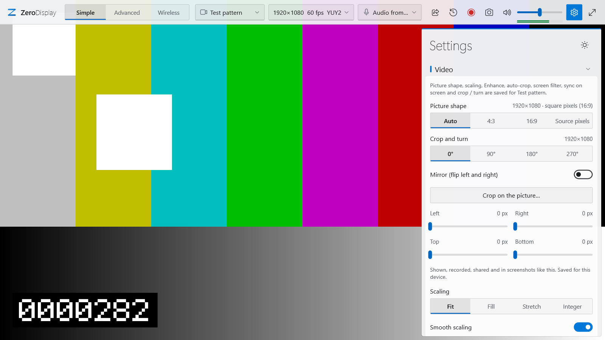

  

<h1 align="center">ZeroDisplay</h1>

  <b>A lightweight, low-latency viewer and recorder for USB / HDMI capture cards on Windows.</b> 
  One small <code>.exe</code>, no installer, no third-party code, free and open source.

  
   
  Call of Duty: Mobile on a Lenovo Legion Y700 (Gen 3), through a USB capture card at 1080p60, scaled to fill the window.

## Why ZeroDisplay?

Plug in a capture card, open ZeroDisplay, and your console (or camera, or second PC) is on screen right away, with
as little delay as the hardware allows. No accounts, no ads, no setup wizard.

- **Low latency, for real**: about 1.5 ms from a frame arriving to it being on screen, and sound that stays in
  sync without drifting. Good enough to play on.
- **Record, clip and look back**: H.264 / HEVC recording on your GPU's encoder, a replay buffer, *Flashback* (rewind
  the live picture while it keeps running) and a lossless trimmer.
- **Stream it around the house**: share to other PCs or any browser on your network, or cast your phone or laptop
  to this PC (Miracast / Smart View / Win+K).
- **Advanced mode** when you need it: scenes, layered sources, filters, chroma key and a studio mode with transitions.
- **Looks like Windows**: follows your light / dark setting and fits in on Windows 10 and 11.
- **Tiny and self-contained**: built only on components that ship with Windows, so there is nothing else to install.

### AI upscaling, before and after

Got a source that only sends 720p, or even less? Turn on **AI upscaling** and ZeroDisplay hands the picture to your
graphics card's own video super resolution before it's shown (NVIDIA RTX Video Super Resolution in these shots).
Soft, blocky edges come out clean. It uses some extra GPU time (about 6.5 ms a frame on an RTX 4060 laptop) and only
changes what's on screen: recordings and streams keep the original signal.

All shots below are the same scene from a Lenovo Legion Y700 (Gen 3) through a USB capture card, zoomed in on the
weapon so you can see the detail.

**720p, upscaled, next to real 1080p.** Plain 720p looks soft. With RTX Video Super Resolution
(1280×720 → 2841×1599) the edges and the fine pattern on the metal sharpen up and get close to what the tablet
sends at native 1080p.

  

**Even 640×480 cleans up.** Normal scaling shows every blocky step; with RTX Video Super Resolution
(640×480 → 2809×2108) the outlines come out smooth.

  

Full screenshots: 720p [off](docs/images/upscaling-720p-off.jpg) / [on](docs/images/upscaling-720p-on.jpg),
[native 1080p](docs/images/native-1080p.jpg), 640×480 [off](docs/images/upscaling-480p-off.jpg) /
[on](docs/images/upscaling-480p-on.jpg).

Works on NVIDIA RTX 20 series and newer, and on Intel Xe / Arc graphics (see
[Enhance and AI upscaling](docs/user-guide.md#enhance-and-ai-upscaling)). No supported GPU? *Enhance* (our own sharpening and
upscaling shaders) works on any graphics card.

### Light and dark

Follows Windows' light or dark mode by itself, or pick one with the sun / moon button next to the Settings title.

  
  

Called **CaptureCard** up to version 1.0. Settings move over by themselves the first time you start ZeroDisplay.

## Download

Grab `ZeroDisplay-<version>-win-x64.zip` from the [latest release](../../releases/latest), unzip it anywhere and run
`ZeroDisplay.exe`. That's it: no installer, and nothing is added to your system.

Want it portable (settings next to the exe, e.g. on a USB stick)? Turn on *Portable* in Settings ▸ General.

### Heads up: Windows SmartScreen will warn you

The first time you run it, Windows will most likely show a blue box saying **"Windows protected your PC"**. That's
expected, and here's why:

- **The exe isn't code-signed.** Signing certificates cost a few hundred dollars a year and need a registered
  business or identity check. ZeroDisplay is a free hobby project, so it ships unsigned for now.
- **It's new.** SmartScreen trusts apps by *reputation*: how many people have downloaded and run that exact file.
  A brand-new release starts with none, so Windows plays it safe and asks you first. The warning tends to go away
  on its own as more people use a release.
- **It's not a virus detection.** SmartScreen is saying "I don't know this app", not "this app is harmful".

To run it anyway: click **More info**, then **Run anyway**. You only have to do this once.

If you'd rather be sure, you can:

- **Check the file hash.** Each release lists the SHA-256 of the zip. In PowerShell:
  `Get-FileHash .\ZeroDisplay-1.1.0-win-x64.zip` and compare it with the one on the release page.
- **Scan it** with Microsoft Defender or upload it to [VirusTotal](https://www.virustotal.com).
- **Build it yourself** from this source code (see [Building from source](docs/building.md)). It takes a few minutes.

## System requirements

- **Windows 11 or Windows 10 22H2**, 64-bit.
- **Minimum:** a 4-core CPU (e.g. Intel Core i5-7300HQ), 4 GB RAM, a DirectX 11 GPU, USB 2.0.
- **Recommended:** 6+ cores, 8 GB RAM, a GPU with a hardware video encoder (Intel Quick Sync, NVIDIA NVENC or AMD),
  a USB 3.0 port and an SSD.
- It's light: about 4 % CPU and 100 MB of RAM to watch 1080p60 on a 2017 laptop.

Full tables, hardware for optional features and the PCs it's tested on: [System requirements](docs/requirements.md).

## Quick start

1. **Connect your source**: plug the capture card into a USB 3 port and your console, camera or PC into the card's
   HDMI input.
2. **Run `ZeroDisplay.exe`**: it finds the card and starts showing its picture and sound. There's nothing to set up.
3. **Move the mouse** to bring up the top bar: pick the device, the format (resolution / fps) and the sound source,
   set the volume, take a screenshot (<kbd>F12</kbd>) or start recording (<kbd>F9</kbd>). The gear opens Settings.
4. **Go full screen** with a double-click or <kbd>F11</kbd>; <kbd>Esc</kbd> brings the window back.
5. **Catch the moment**: turn on the *Replay buffer* in Settings ▸ Recording and press <kbd>F8</kbd> to save the last
   seconds, or press <kbd>←</kbd> to rewind the live picture with *Flashback*.

Press <kbd>F1</kbd> any time for every key.

## Features

- **Watch:** low-latency preview, any resolution and frame rate, hot-plug, several devices at once.
- **Record:** H.264 / HEVC on your GPU, replay buffer, *Flashback* to rewind live, lossless trimmer, screenshots.
- **Picture:** Enhance and AI upscaling, crop / turn / mirror, retro screen filters, auto-crop, HDR (experimental).
- **Share and cast:** watch on other PCs or in a browser (PIN protected), receive casts from Android and Windows,
  and make a Wi-Fi network for phones.
- **Advanced mode:** scenes, layered sources, chroma key and other filters, studio mode with transitions.
- **Handy extras:** mini player, clean output, global hotkeys, lag check, battery and memory savers, portable mode.

Every feature and where to find it: [Features at a glance](docs/user-guide.md#features-at-a-glance).

## Documentation

- [User guide](docs/user-guide.md): every feature and setting, plus all keyboard shortcuts
- [System requirements](docs/requirements.md): supported Windows versions, minimum and recommended specs
- [FAQ and troubleshooting](docs/faq.md): no picture, no sound, lag, OBS, where files go
- [How it works](docs/how-it-works.md): what it's built on and how the latency stays low
- [Building from source](docs/building.md): build it yourself, self-tests, roadmap
- [Changelog](CHANGELOG.md)

## Contributing

Bug reports and ideas are welcome: open an [issue](../../issues) and include what you see, your capture card, and
the log (Settings ▸ General shows where the settings and `log.txt` are kept). Pull requests are welcome too; the
project sticks to Windows' built-in APIs only, so please don't add third-party libraries.

## License

ZeroDisplay is free and open source under the [MIT License](LICENSE). Use it, change it, share it.
